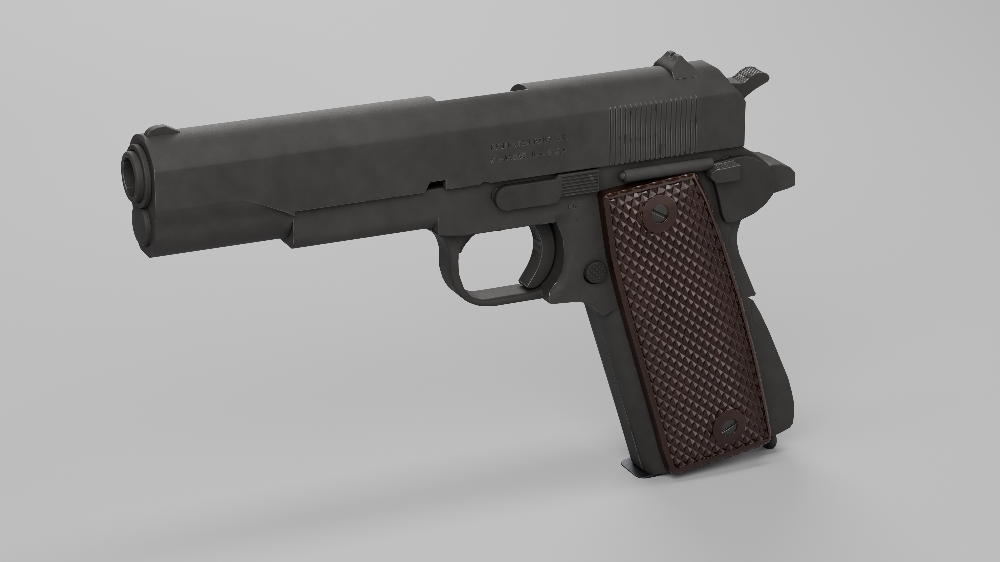
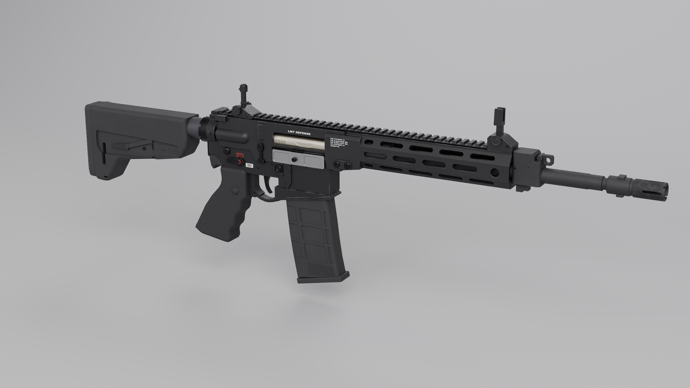
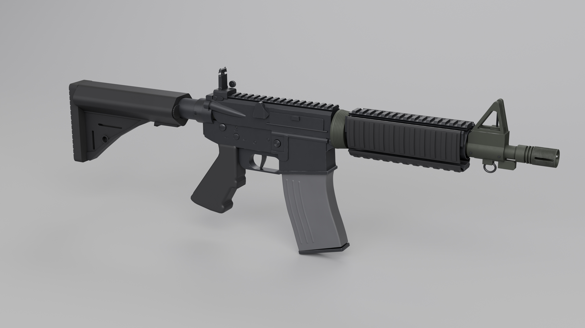

# Шесть фотореалистичных моделей оружия в Blender (Claude Opus 5.5)

Шесть художественных 3D-моделей реального оружия. Каждая построена с нуля кодом Python/bpy через MCP для Blender, без генераторов, библиотек и сторонних моделей. Для каждого образца по источникам выбран конкретный вариант, размеры сведены с источниками, модель сверена с калиброванными фото. Маркировки вырезаны в геометрии, детали проверены автоматическим аудитом и независимым ревью.

| | | |
|---|---|---|
|  **M1911A1** (Remington Rand, 1943–45) |  **Desert Eagle** Mark XIX .50 AE 6″ |  **Remington 870** Hardwood Home Defense |
|  **AR-15** — LMT R20 RAHE Reference |  **АК-47** «тип 3», Ижмаш 1956–57 |  **M4A4** (CS:GO) — Mk 18 Mod 0 CQBR |

## Модели

| Модель | Файл | Общая длина, мм: источник / модель | Ствол, мм: источник / модель | Объектов | Полигонов |
|---|---|---|---|---|---|
| M1911A1 | [`M1911/M1911.blend`](M1911/M1911.blend) | 218.3 / 218.1 | 127.8 / 127.8 | 48 | 101 658 |
| Desert Eagle Mark XIX | [`Desert Eagle/DesertEagle.blend`](Desert%20Eagle/DesertEagle.blend) | 273.05 / 272.66 | 152.4 / 152.41 | 68 | 260 674 |
| Remington 870 | [`Remington 870/Remington870.blend`](Remington%20870/Remington870.blend) | 978 / 977.2 | 470 / 470.0 | 54 | 850 175 |
| AR-15 (LMT R20) | [`AR-15/AR15.blend`](AR-15/AR15.blend) | ≈824 / 823.1 | 363 / 363.0 | 87 | 192 668 |
| АК-47 «тип 3» | [`AK 47/AK47.blend`](AK%2047/AK47.blend) | 870 / 869.7 | 415 / 415.0 | 79 | 163 688 |
| M4A4 = Mk 18 Mod 0 | [`M4A4/M4A4.blend`](M4A4/M4A4.blend) | ≈713 / 717.4 | 262 / 261.6 | 60 | 181 883 |

Полигоны посчитаны после модификаторов. Подробности по каждой модели — в её `asset-state.md`: вариант и почему он выбран, таблица размеров, допущения, разбор ревью. Общий отчёт с выводами и подсчётом стоимости работы — в [`REPORT.md`](REPORT.md).

## Как открыть

- Blender 5.2 или новее (модели сделаны в 5.2.2 LTS), рендер Cycles.
- Единицы — метры. Начало координат — на зеркале затвора на оси канала, ствол направлен по +X, верх по +Z.
- Студия (циклорама, свет, камеры `CAM_Hero`, `CAM_Left`, `CAM_*` для крупных планов) лежит в коллекции `Studio`. HDRI подключён относительным путём из [`assets/hdri`](assets/hdri), поэтому папку `assets` нужно держать рядом с папками моделей.
- Положения «затвор открыт» и разнесённый вид в файлах не сохранены. Они задавались смещениями деталей при рендере и описаны в `asset-state.md`.

## Что в репозитории и чего нет

- Есть: основные `.blend`, финальные рендеры (JPEG), документы, отчёты аудита, тексты ревью, HDRI `studio_small_09` ([Poly Haven](https://polyhaven.com/a/studio_small_09), CC0).
- Нет: фото-референсов и листов сравнения с ними, потому что это чужие фотографии; их адреса перечислены в `web_refs/sources.md` каждой модели. Также не включены промежуточные версии, рабочие скрипты и логи.
- Серийные номера на моделях вымышленные. Названия и логотипы производителей принадлежат их владельцам.
- Это визуальные арт-модели для рендера. Они не являются чертежами и не годятся для изготовления деталей.

---

## English summary

Six photorealistic art models of real firearms, built from scratch in Blender with Python/bpy over MCP by Claude Opus 5.5:

- M1911A1 (Remington Rand, 1943–45);
- Desert Eagle Mark XIX .50 AE 6″;
- Remington 870 Hardwood Home Defense;
- LMT R20 RAHE AR-15;
- AK-47 "Type 3" (Izhevsk, 1956–57);
- Mk 18 Mod 0, which appears as the "M4A4" in CS:GO.

How each model was made:

- a specific variant was chosen from sources and its dimensions were matched to those sources;
- the silhouette was checked against calibrated photos (IoU 0.93–0.99);
- the markings are engraved geometry;
- an automated audit passed and an independent review was done for every model.

Open the `.blend` files in Blender 5.2+ and keep the `assets` folder next to them for the studio HDRI. Reference photos are not included for copyright reasons; their links are listed in each model's `web_refs/sources.md`. Serial numbers are fictional. These are visual models only, not engineering drawings.
